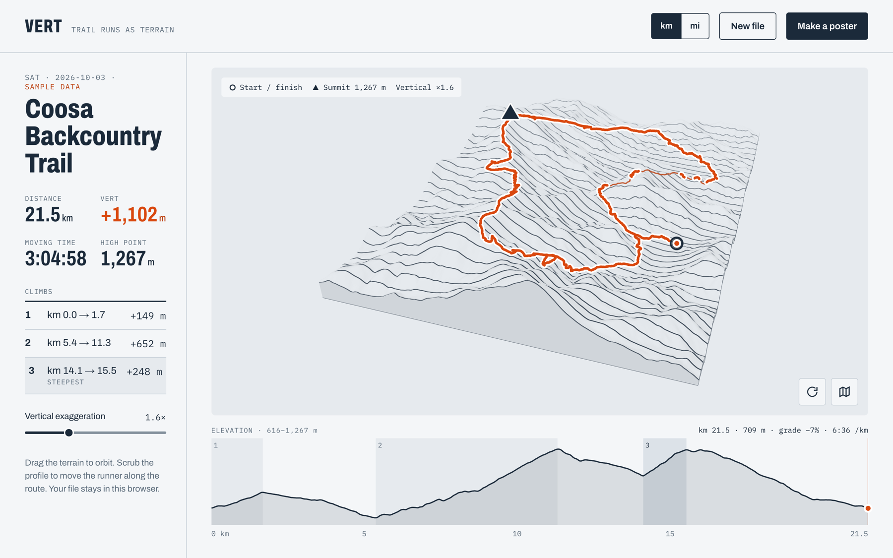
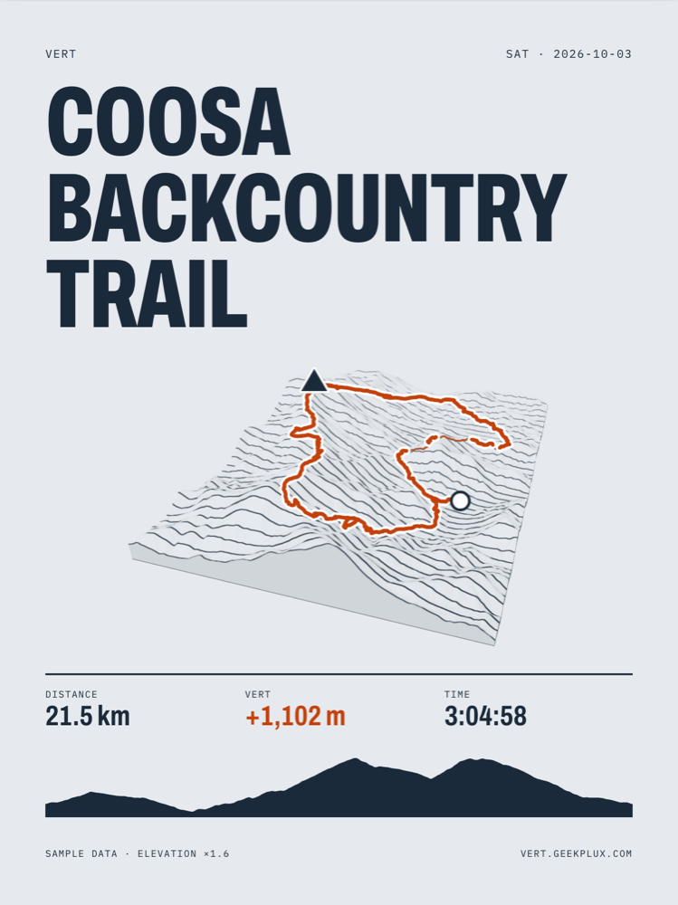
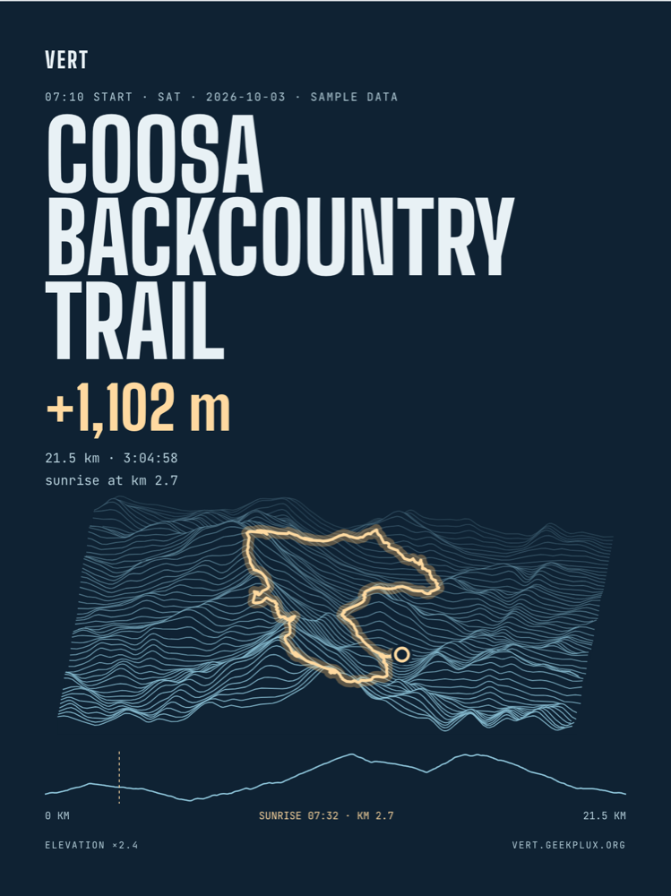
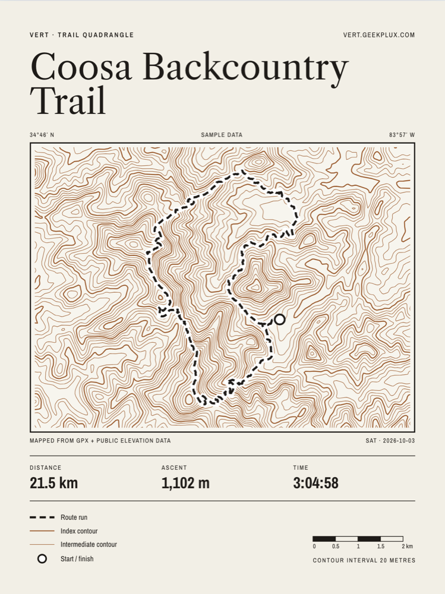
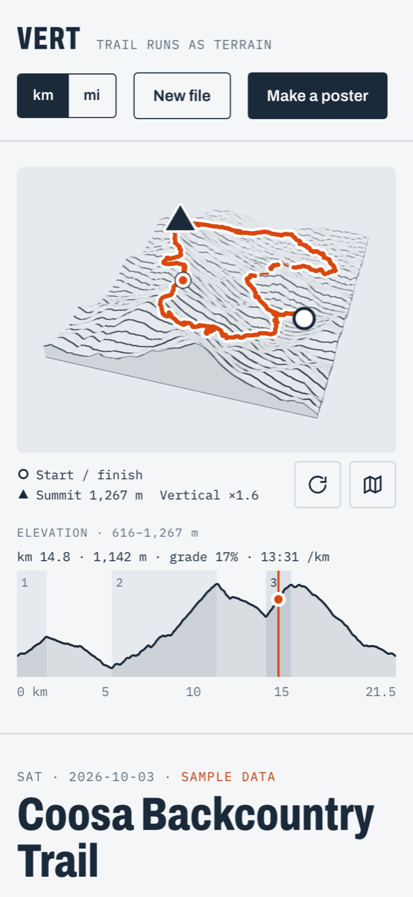

<div align="center">

# VERT

**Drop a GPX. Get a poster.**

Vert turns one GPX file into a 3D terrain view of your run, ride or hike, then into a print-ready
poster. Everything happens in your browser: your track never leaves your device.

### [**Open Vert → vert.geekplux.com**](https://vert.geekplux.com)

[](https://vert.geekplux.com)
[](LICENSE)
[](tsconfig.json)
[](package.json)
[](https://threejs.org)
[](wrangler.jsonc)
[](#accessibility)



</div>

## Why Vert

Strava shows your run as a line on a flat map. Vert shows the ground you actually ran over, so a
climb looks like a climb and a ridge looks like a ridge. Make one poster of a run you want to keep,
in a style you would hang on a wall.

- **Instant 3D terrain.** Drop a `.gpx` file and the route sits on real elevation data in about a
  second. Orbit, zoom, switch to a flat map, and adjust the vertical exaggeration.
- **Scrub the run.** Drag along the elevation profile, or use the arrow keys, and a marker follows
  you over the terrain with distance, elevation, grade and pace at that point.
- **Climbs, found for you.** Vert picks out the main climbs, shades and numbers them on the profile,
  and flags the steepest one.
- **Three poster styles,** each with its own palette, typefaces and way of drawing terrain.
- **Print-quality export.** PNG up to 18 × 24 in at 300 dpi (5400 × 7200), and a PDF for print.
  The poster is rendered in tiles in your browser, so large sizes don't crash the tab.
- **Privacy built in.** Parsing, rendering and export all happen on your device. The poster hides
  the first and last 200 m of the route by default, so it doesn't show where you live.
- **No account.** No sign-up, no saved history.
- **Embeddable.** A small library (about 30 KB gzipped, plus three.js) puts the terrain view and
  profile on any React page from a pre-baked scene file that contains no coordinates.

## Posters

<table>
  <tr>
    <td align="center" width="33%"><br><b>A · Trail Sign</b><br><sub>Oblique 3D terrain, flat facets, a bold signage title</sub></td>
    <td align="center" width="33%"><br><b>B · Night Ridge</b><br><sub>Glowing ridge lines on dark paper, with sunrise on the profile</sub></td>
    <td align="center" width="33%"><br><b>E · Survey Quad</b><br><sub>A topographic map with 20 m contours, a legend and a scale bar</sub></td>
  </tr>
</table>

Sizes: **18 × 24 in** (5400 × 7200), **A3** (3508 × 4961), **4:5** (1080 × 1350) and **9:16**
(1080 × 1920). You can edit the title, subtitle and signature, choose which stats appear, and set how
much of the start and end to hide (0 to 500 m).

## Try it

The quickest way is the website: open **[vert.geekplux.com](https://vert.geekplux.com)**, click
**Try the sample run** or drop a `.gpx` file onto the page. Nothing is uploaded, so it works the same
as running it yourself.

To run it locally:

```sh
git clone https://github.com/geekplux/vert.git
cd vert
pnpm install
pnpm dev
```

Open the URL Vite prints and click **Try the sample run**, or drop any `.gpx` file onto the page.
Files from Strava, Garmin, Coros and Suunto all work, up to 20 MB.

A site that publishes baked scenes can link straight to one:
`https://vert.geekplux.com/?scene=<absolute URL of a .scene file>` opens it in the 3D view
([try it](https://vert.geekplux.com/?scene=https%3A%2F%2Fvert.geekplux.com%2Fsamples%2Fcoosa-backcountry.scene&title=Coosa%20Backcountry);
[how to link](docs/INTEGRATION.md#link-to-vert)).

**Requirements:** Node.js ≥ 22.18 (see `.nvmrc`) and pnpm. In development, elevation tiles are
proxied straight to the public AWS bucket, so you don't need a Cloudflare account to run Vert
locally.

<details>
<summary><b>On a phone</b></summary>
<br>


The page works down to 390 px wide. Every control is at least 44 px tall, and the terrain and
profile stack into one column.

</details>

## How it works

```text
 .gpx ──► Web Worker parser ──► track + stats ──► tile z/x/y ──► /tiles/{z}/{x}/{y}.png
 (never uploaded)                (distance, vert,                     │
                                  climbs, pace)                       ▼
                                                        Cloudflare Worker ─► R2 cache ─► AWS Terrain Tiles
                                                                      │
                                         Terrarium PNG → height grid ◄┘
                                                    │
                       three.js mesh + route + markers ──► View  ──► Poster (tiled export → PNG / PDF)
```

1. **Parse.** A Web Worker reads the GPX (no `DOMParser` there), then works out distance, elevation
   gain with noise filtering, moving time, the high point and the climbs.
2. **Fetch elevation.** The browser asks for [AWS Terrain Tiles](https://registry.opendata.aws/terrain-tiles/)
   by tile number only. A Cloudflare Worker proxies them and caches them in R2. The track's
   coordinates never appear in any request.
3. **Render.** Terrarium-encoded PNGs are decoded into a height grid. three.js draws it as a custom
   mesh with shaders, and the route is draped over the ground.
4. **Export.** Print sizes are rendered as tiles of at most 4096 px and stitched together in an
   `OffscreenCanvas`, then saved as a PNG or a PDF.

One Worker serves both the static app and the `/tiles` proxy (`wrangler.jsonc`).

## Privacy

Vert is built so that it can't leak your location:

- Your GPX file is read, rendered and exported in the browser. Nothing is uploaded.
- The only requests that depend on your run are elevation tiles, and they carry `z/x/y` and nothing
  else: no query strings, no cookies, no referrer.
- There is no third-party CDN. Fonts are self-hosted.
- The live site (vert.geekplux.com, and nowhere else) loads Google Analytics to count page views.
  It is told the page's origin and path and its fixed title: no query string (so no `?scene=`
  address), no run name, no events from the app. Google signals and ad personalisation are off.
- A `?scene=` link makes the page fetch that one file from the host it names, with no cookies and
  no referrer. A scene holds no coordinates, and nothing about it is stored or sent on.
- Posters hide the first and last stretch of the route (200 m by default).
- Scenes baked for embedding are checked before they are written. Automated scanners look for
  coordinates, tile numbers and timestamps, and run regression attacks that try to recover the
  latitude from the terrain itself. See [`docs/SCENE.md`](docs/SCENE.md).

An end-to-end test drops a file and checks that the only requests made are for the app's own assets
and tile `z/x/y` paths.

## Accessibility

Vert was designed with and for a color-weak runner, so color never carries information on its own:

- Start is a ○, the summit a ▲, the scrub position a ● with a white ring. Climbs are shaded **and**
  numbered.
- The whole app works from the keyboard, with a visible 2 px focus ring. The profile behaves as a
  slider (arrow keys move 1%, Shift+arrow 10%), and the terrain orbits with the arrow keys.
- Text contrast is at least 4.5:1, and touch targets are at least 44 px.
- The terrain canvas has a descriptive label, and the stats and climbs beside it are its text
  alternative.
- With `prefers-reduced-motion`, the intro animation becomes a fade.
- axe-core reports 0 violations across every page state at desktop and phone widths.

## Use it in your site

Vert is also a library on npm, [`@geekplux/vert`](https://www.npmjs.com/package/@geekplux/vert):
`TerrainView`, `ElevationProfile`, `decodeScene` and a scrub-sync API, so the view can follow a
heart-rate or pace chart. It has no network code and no geodesy: it draws a `.scene` file that
the package's `vert-bake` command bakes offline, on your machine, from a `.gpx` or a points file.

```sh
pnpm add @geekplux/vert three@0.186.1
pnpm exec vert-bake my-run.gpx --out public/scenes   # → <id>.scene + <id>.scene.json, about 20–60 KB
```

```tsx
import { ElevationProfile, TerrainView, decodeScene } from '@geekplux/vert';
import '@geekplux/vert/vert.css';

const scene = decodeScene(new Uint8Array(await (await fetch(url)).arrayBuffer()));

function RunTerrain() {
  const [scrub, setScrub] = useState<number | null>(null);
  return (
    <>
      <div style={{ aspectRatio: '16 / 9' }}>
        <TerrainView
          scene={scene}
          exaggeration={1.6}
          scrub={scrub}
          ariaLabel="3D terrain of my morning run"
        />
      </div>
      <ElevationProfile scene={scene} scrub={scrub} onScrub={setScrub} />
    </>
  );
}
```

A scene holds a height grid and a route in local metres. It has no latitude, no longitude and no
tile numbers. The full host guide (installing, baking, caching, theming with CSS custom
properties, syncing the scrub with a time chart, and testing) is in
[`docs/INTEGRATION.md`](https://github.com/geekplux/vert/blob/main/docs/INTEGRATION.md).

## Development

| Command                      | What it does                                                        |
| ---------------------------- | ------------------------------------------------------------------- |
| `pnpm dev`                   | Vite dev server                                                     |
| `pnpm build`                 | Typecheck, then a production build to `dist/`                       |
| `pnpm test`                  | Vitest unit tests (app, scene format, bake and Worker)              |
| `pnpm test:e2e`              | Playwright against the production build, at 1440 and 390 wide       |
| `pnpm lint`                  | ESLint and the Prettier check                                       |
| `pnpm typecheck`             | `tsc -b` across the app, Node, scripts and Worker configs           |
| `pnpm stories`               | The Ladle component workshop on http://localhost:61000              |
| `pnpm build:lib`             | The npm package's contents (library and `vert-bake`) to `dist-lib/` |
| `pnpm bake <in> --out <dir>` | Bake a `.gpx` or points `.json` into a `.scene` and its sidecar     |
| `pnpm worker:dev`            | Run the tile Worker locally                                         |
| `pnpm posters`               | Regenerate the poster examples, screenshots and social card ¹       |

¹ Needs `pnpm build && pnpm preview --port 4173` running, and macOS `sips` and `cwebp` (see the
header of `scripts/capture-posters.mjs`).

Before opening a pull request, run `pnpm lint && pnpm typecheck && pnpm test && pnpm build`.

```text
src/components  UI pieces, one folder each (component, CSS module, stories, tests)
src/page        the one page and its four states: Upload, View, Poster mode, Exporting
src/gpx         GPX parser and stats, run in a Web Worker
src/terrain     three.js mesh, shaders, route, markers, camera
src/poster      poster styles A, B and E, and tiled export
src/scene       the .scene format: codec, builder, privacy scanners
src/vert-lib    the embeddable library's entry and public types
scripts/bake    the headless scene bake (Node, no DOM)
worker/         Cloudflare Worker: the /tiles proxy with an R2 cache
e2e/            Playwright tests
docs/           design spec and canvas, decisions, scene format, integration and release guides
```

## Documentation

- [`docs/DESIGN-SPEC.md`](docs/DESIGN-SPEC.md): design tokens, components, page states, poster
  styles and accessibility rules
- [`docs/DECISIONS.md`](docs/DECISIONS.md): every design and engineering ruling, with the reasons
- [`docs/SCENE.md`](docs/SCENE.md): the binary scene format, the bake and its privacy model
- [`docs/INTEGRATION.md`](docs/INTEGRATION.md): how a host page embeds Vert
- [`docs/PUBLISH.md`](docs/PUBLISH.md): how a release reaches npm
- [`docs/design/`](docs/design): the design canvas's frames, as HTML source and PNG renders
- A `README.md` in each main folder says how that part works: [`src/page`](src/page/README.md),
  [`src/components`](src/components/README.md), [`src/gpx`](src/gpx/README.md),
  [`src/terrain`](src/terrain/README.md), [`src/poster`](src/poster/README.md),
  [`src/lib`](src/lib/README.md), [`src/vert-lib`](src/vert-lib/README.md) and
  [`worker`](worker/README.md)

## Contributing

Issues and pull requests are welcome. A few house rules keep Vert small and safe:

- **Scope.** Vert does one GPX in and one poster out. Training analysis, accounts and sync with
  other services are out of scope.
- **Ask before adding a dependency,** including dev dependencies. There is no map library and no
  basemap, by design.
- **Never use color alone** to carry information, and keep everything keyboard operable.
- **No request may carry track data.** Elevation tile requests carry `z/x/y` only.
- Tests sit next to the code. Query by role and label, not by class name.

## Credits

- Elevation: [AWS Terrain Tiles](https://registry.opendata.aws/terrain-tiles/), Mapzen terrain from
  [various sources](https://github.com/tilezen/joerd/blob/master/docs/attribution.md).
- Sample route: the Coosa Backcountry Trail, © [OpenStreetMap](https://www.openstreetmap.org/copyright)
  contributors (ODbL), with synthetic timing. It isn't anyone's actual run.
- Typefaces, self-hosted under the SIL Open Font License: Archivo, Archivo Narrow, IBM Plex Mono,
  Big Shoulders Display, Libre Caslon Text and JetBrains Mono.
- Built with [three.js](https://threejs.org), [React](https://react.dev), [Vite](https://vite.dev),
  [Vitest](https://vitest.dev), [Playwright](https://playwright.dev) and
  [Ladle](https://ladle.dev).

## License

[MIT](LICENSE) © 2026 Sean G
